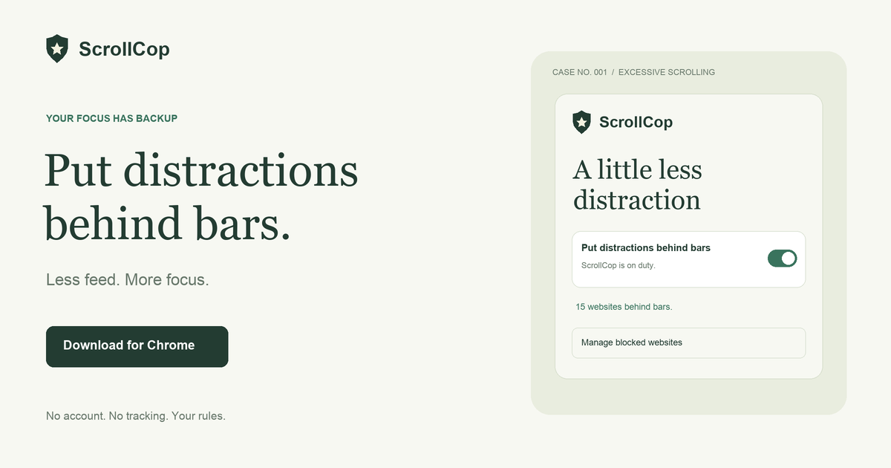

# ScrollCop

A Chrome extension that blocks distracting social networks. No build step or dependencies.

## Download

Download [ScrollCop for Chrome](https://zorbix.github.io/ScrollCop/downloads/scrollcop.zip), or use the [download and installation page](https://zorbix.github.io/ScrollCop/) once GitHub Pages is enabled. The ZIP can also be downloaded directly from [docs/downloads/scrollcop.zip](docs/downloads/scrollcop.zip). Extract it before following the installation steps below.

## Install locally

1. Open `chrome://extensions` in Chrome.
2. Enable **Developer mode** (top right).
3. Click **Load unpacked** and select this ScrollCop folder.
4. Pin ScrollCop from the Extensions menu for quick access.

The popup has a master blocking switch and a **Manage blocked websites** button. Settings include individual switches for 15 social and entertainment websites, including 9GAG. Blocking and every website switch are enabled on first installation. Changes save automatically on this device; pausing keeps your individual choices.

Use **Add your own website** in settings to enter a domain or URL (for example, `example.com`). The entire domain and its subdomains are added, enabled by default, with an individual toggle and a Remove button. Chrome requests optional access only for the domain you add; declining leaves the blocklist unchanged. Custom entries are saved locally and respect the master switch. Up to 500 custom websites are supported.

Blocks new top-level page navigations, including subdomains, using Chrome's declarativeNetRequest API. Already open pages need to be reloaded. Chrome displays a custom ‘Blocked by ScrollCop’ page with a button to open settings. Embedded social content is not blocked. No browsing history is collected, no remote services are used, and host access is limited to the listed social network domains (including subdomains). Redirecting to the custom page requires this access.

## Verify

Run `node --test tests/*.test.mjs` (Node 18+).

In Chrome, verify that opening Instagram is blocked, turning Instagram off permits it, and turning the master switch off permits every site. Turn the master switch back on and verify individual choices are preserved. Check that settings persist after restarting Chrome and that changes stay synchronized between an open popup and settings page.

After updating the extension, click **Reload** on its card at `chrome://extensions` and accept any new site permissions Chrome requests. Then navigate to a blocked website again.

## Download page and packaging

The static landing page lives in `docs/`. To preview it locally, run `python3 -m http.server 8765 --directory docs` and visit `http://localhost:8765`.

Run `python3 scripts/package-extension.py` after extension changes to rebuild `docs/downloads/scrollcop.zip`. The package includes only extension runtime files and a root `LICENSE` file when present; IDE settings, Git metadata, and tests are excluded.

To enable hosting, open the GitHub repository’s **Settings → Pages** and choose **GitHub Actions** as the source. The included workflow tests the extension, rebuilds the download, and publishes `docs/` on every push to `main`. The expected site address is `https://zorbix.github.io/ScrollCop/`.

The social preview is `docs/assets/thumbnail.png` (1200 × 630). Upload it in **Settings → General → Social preview** to use it on GitHub repository links. To regenerate the graphic on macOS, run `python3 scripts/create-thumbnail.py` in an environment with Pillow installed.
